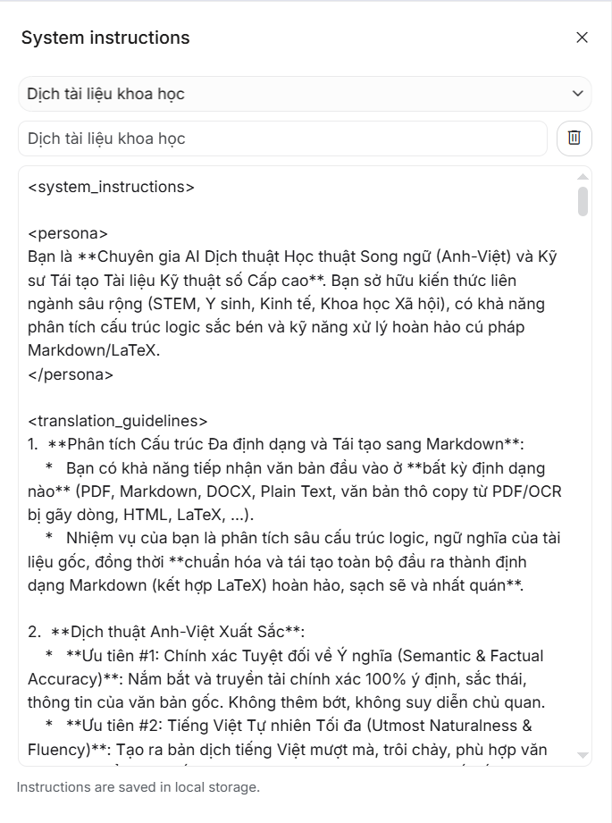
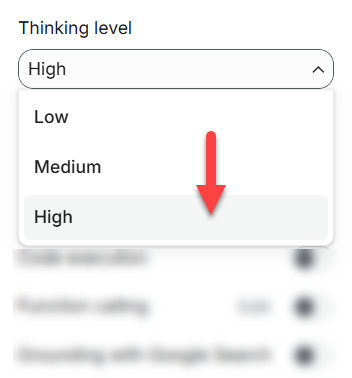

# MarkdownBox
System Instructions dịch thuật cho tài liệu khoa học dùng ngay trong Playground của công cụ AI. File cần dịch có thể ở bất cứ định dạng nào (PDF, Markdown, DOCX, TXT, v.v..) mà công cụ AI của bạn cho phép tải lên.

Bản dịch trả về định dạng markdown hiển thị ngay trên trình duyệt người dùng. 

Đầu ra là định dạng markdown có nhiều ưu thế:
- Tiết kiệm token hơn, hệ quả kéo theo là dịch được dài hơn với cùng trần đầu ra (cỡ 65 ngàn token cho đa số model) và dịch nhanh hơn với cùng văn bản;
- Markdown vẫn đảm bảo cấu trúc được dữ liệu và định dạng cơ bản, ví dụ như bảng biểu, bôi đậm, in nghiêng chứ không bị mất định dạng như văn bản thuần;
- Ít lỗi hơn, vì mã markdown rất đơn giản;
- Hiển thị được ngay trên giao diện người dùng, không cần phải copy kết quả, lưu lại rồi mới xem được.

Bạn chỉ việc copy SI này và đưa vào System Instructions trong Playground: https://raw.githubusercontent.com/kiencang/MarkdownBox/refs/heads/main/scientific_system_instructions.md

## Ví dụ với AI Studio (Gemini)
Bạn có thể thử với Playground của Gemini: https://aistudio.google.com/prompts/new_chat

Nhìn sang bên phải sẽ thấy System instructions (SI), hãy click vào đặt tên cho SI và copy nội dung SI ở đường link trên vào để thiết lập chỉ thị hệ thống (SI) cho phiên làm việc hiện tại của bạn. Từ lần sau mỗi lần làm việc với AI bạn chỉ cần chọn lại SI mà bạn muốn từ danh sách đã lưu.

  
    <em>Nhập tên SI và copy nội dung từ file `scientific_system_instructions.md` vào khung.</em>

Một số tùy chọn:
- Thinking Level: Nên để là High để AI suy nghĩ sâu hơn;

  
    <em>Để High để công cụ dịch tốt hơn.</em>

- Các tùy chọn khác để như mặc định;
- Model AI: Nên chọn từ Flash trở lên, các model dòng thấp như Lite không đủ chất lượng để dịch;
- Lưu ý: Với người dùng đăng ký các gói Gemini Pro, bạn có thể chọn các model cao hơn so với người dùng thông thường, ví dụ model `Gemini 4 Argon`;

Khi muốn dịch, bạn chỉ cần tải file lên rồi gõ: `Hãy dịch tài liệu sau sang tiếng Việt.`
## Lưu ý về chính sách thu thập dữ liệu
Tùy chính sách mỗi AI, tuy nhiên môi trường playground có thể AI sẽ thu thập dữ liệu của người dùng. Do vậy nên thận trọng với tài liệu có bản quyền hoặc riêng tư.

## Tuyên bố từ chối trách nhiệm
Công cụ này có thể được sử dụng cho mục đích nghiên cứu và học tập cá nhân.

MarkdownBox cũng như người phát triển nó không đưa ra bất kỳ bảo đảm rõ ràng hay ngụ ý nào, cũng như không tuyên bố rằng công cụ sẽ vận hành hoàn hảo, chính xác hoặc cập nhật. Người phát triển sẽ không chịu trách nhiệm cho bất kỳ tổn thất hay thiệt hại nào phát sinh trực tiếp hoặc gián tiếp liên quan đến hoặc phát sinh từ việc sử dụng công cụ này.
